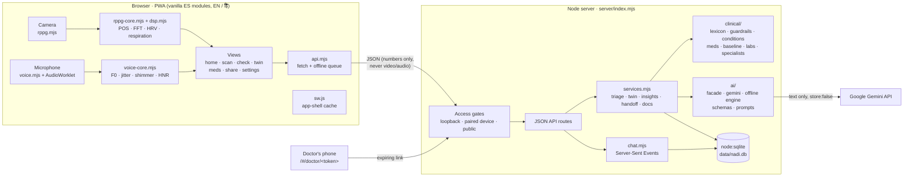
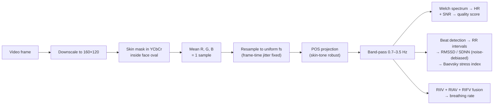
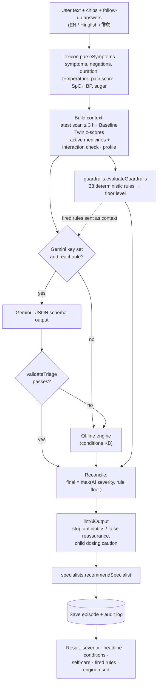
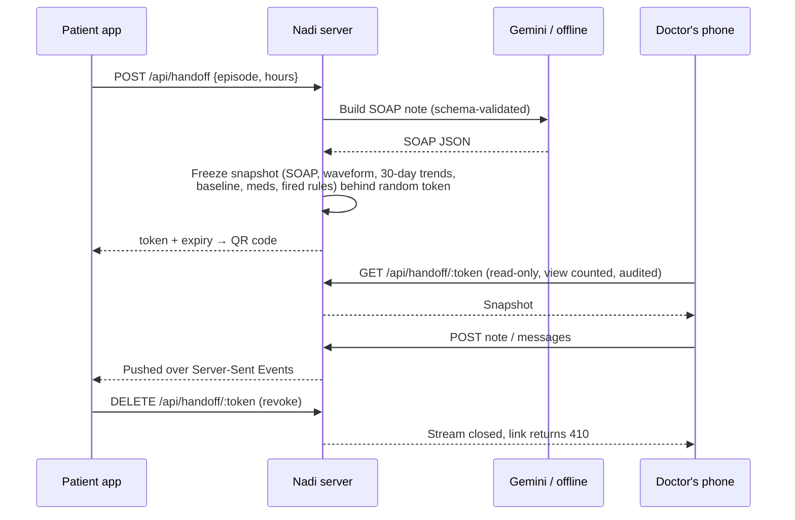
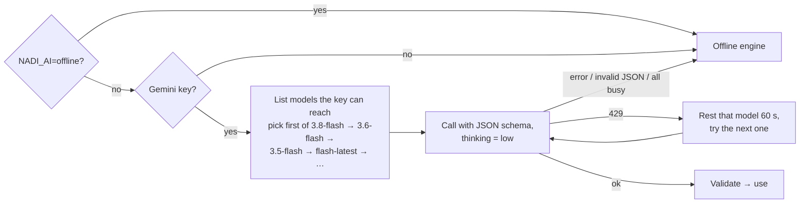

# Nadi — *Nadi Pariksha, reimagined*

**Theme 4 · Healthcare & Well-being — Reimagining Healthcare Through Technology**

**Team Delta** · Pranjal Mishra · Vishal Kumar Sahu · Vikash Singh

Nadi (नाड़ी, "pulse") turns any phone or laptop camera into a vital-signs sensor and pairs it with AI symptom triage that is **wrapped in deterministic clinical safety rules**. It compares every reading with *your own* baseline, and hands your doctor a ready-to-read clinical note through an expiring QR link.

| | What it does | Why it matters |
|---|---|---|
| 📷 **Contactless vitals** | A 30–60 s face scan recovers your pulse waveform from invisible skin-colour changes (remote photoplethysmography) → heart rate, breathing rate, HRV and stress index. An optional 10 s "aaah" voice test adds jitter, shimmer, HNR and maximum phonation time. | No wearable, no lab, no cost. Video and audio never leave the device. |
| 🛡️ **Guarded AI triage** | Symptoms in English, Hindi or Hinglish → Gemini reasons over symptoms + vitals + baseline + medicines → **38 cited red-flag rules** run independently and can only *escalate* the AI's verdict, never soften it. An output lint strips self-prescribed antibiotics and false reassurance. | "How do you stop the AI giving dangerous advice?" — this is the answer, and every decision shows *why*. |
| 📈 **Baseline Twin** | Robust personal baseline (median ± MAD); flags readings ≥ 2 SD from *your* normal, and excludes exercise, caffeine and low-quality scans from the baseline. | "72 bpm is normal" is useless; "+21 bpm over *your* normal for 2 days" catches illness early. |
| 💊 **Medicine safety** | Maps 160 Indian brand and generic names to 97 ingredients → catches Dolo 650 + Sinarest = double paracetamol, checks the daily paracetamol total against the 4 g limit, and applies 18 interaction rules (bleeding, serotonin, nitrate + sildenafil…). Tracks adherence. | Duplicate-ingredient overdoses and self-medication are common and preventable. |
| 🩺 **Doctor handoff** | One tap → SOAP note + pulse waveform + 30-day trends against baseline + safety flags behind a QR link that expires (4 h / 24 h / 3 d), is read-only, view-logged and revocable. The doctor can reply. | A 7-minute OPD visit starts with data instead of "kab se ho raha hai?" |

It works **fully offline**: without an API key or internet, a built-in clinical engine (knowledge base + guardrails) answers, and the UI says so honestly.

---

## Quick start

```bash
npm install            # 2 dependencies: @google/genai, qrcode
npm start              # → http://localhost:3000
```

Requires **Node 22.13+** (built-in SQLite). On first launch choose **"Explore with demo data"**, or set up a profile.

- **Gemini (optional):** Settings → AI engine → paste a key from <https://aistudio.google.com/apikey> → *Save & test*. Or copy `.env.example` to `.env`. Nadi lists the models your key can reach and picks the best one (`gemini-3.8-flash` → `3.6-flash` → `3.5-flash` → `gemini-flash-latest` …). A triage answer takes about 10 s. If a free-tier rate limit is hit (HTTP 429), that model rests for 60 s and the next one answers; if all are exhausted, the offline engine answers and says so.
- **Phone camera:** phones only allow cameras on HTTPS. Run `npm run certs` once and restart. Then on the laptop open Settings → *Use on your phone* and scan the pairing QR. Accept the one-time certificate warning on the phone. Both devices must be on the same Wi-Fi; re-run `npm run certs` if the laptop's IP changes.
- **Tests:** `npm test` runs 58 tests: ground-truth signal tests on synthetic physiology, clinical-logic tests and API tests (see [Testing](#testing)).

## 3-minute demo script

1. **Home** (demo data loaded). The Baseline Twin banner says *"Your body looks different from your normal today"*: resting HR is +21 bpm (+6.3 SD) and HRV has fallen. Point out that the change started two days *before* the fever (Twin → HR chart).
2. **Scan** → *Start scan* (sit still, face a window). Show the live waveform, the FFT peak locking onto the heart rate, and the *"Show detected skin pixels"* x-ray. Then do the voice test and save.
3. **Check** → type **"kal se bukhar hai 101, badan dard aur aankhon ke peeche dard"** → *Assess*. You'll see the pipeline run (parse → 38 safety rules → AI → post-check), then *Possible dengue — see a doctor within 1–2 days*, the Twin rule with its citation, "paracetamol only, avoid ibuprofen", and the **duplicate-paracetamol** warning from the medicine list.
4. Show the guardrail: type **"seene mein dard, baayein haath tak ja raha hai, paseena"** → **Emergency**, with *Call 112 / 108* buttons and first-aid steps. Mention that the rules can only escalate.
5. **Doctor** → *Create doctor link* → scan the QR with another phone on the same Wi-Fi. The clinician view shows the SOAP note, the real pulse waveform, trends against baseline, and a reply box. Send a note and it appears back on the patient's Doctor page.
6. **Settings** → open *Safety guardrails* to show all 38 rules with their sources, then *Your data* (export, delete everything, audit log).

## Architecture

Nadi is a single Node.js process that serves both a JSON API and a Progressive Web App. There is no framework, no build step and no external database: the backend uses Node's built-in `http`/`https` and `node:sqlite`, and the frontend is plain ES modules loaded directly by the browser. The only two npm dependencies are `@google/genai` (Gemini) and `qrcode`.

The design follows three principles:

1. **Signals are processed at the edge.** Camera and microphone data are turned into numbers *inside the browser*. The server only ever receives numbers such as heart rate, HRV or jitter.
2. **The AI is advisory; the rules are authoritative.** Gemini proposes a triage. Deterministic, cited clinical rules can raise its severity but never lower it.
3. **Everything degrades gracefully.** No key, no internet or a rate limit? The offline clinical engine answers. Phone loses Wi-Fi mid-scan? The reading is queued and synced later.

### System overview



### Components

| Layer | File(s) | Responsibility |
|---|---|---|
| **App shell** | `public/app.mjs`, `index.html`, `styles.css` | Hash router (`#/scan`, `#/check`, …) that lazy-loads one view module per screen; theme, language, session and offline banner. |
| **Views** | `public/views/*.mjs` | One file per screen: `home`, `scan`, `check`, `twin`, `meds`, `share`, `settings`, `doctor` (clinician view), `pair`, `welcome`. |
| **Signal processing** | `public/lib/rppg.mjs`, `rppg-core.mjs`, `dsp.mjs` | Camera capture → per-frame mean skin RGB → POS pulse signal → HR, beats, HRV, breathing rate, stress, quality score. The `*-core` files are pure functions, so the same code runs in the browser and in Node tests. |
| **Voice** | `public/lib/voice.mjs`, `voice-worklet.js`, `voice-core.mjs` | Microphone samples captured by an AudioWorklet → pitch (NCCF) → jitter, shimmer, HNR, maximum phonation time. |
| **Client utilities** | `public/lib/api.mjs`, `charts.mjs`, `i18n.mjs`, `ui.mjs` | API client with an offline queue for readings, canvas charts with baseline bands, English/Hindi strings, tiny DOM helpers. |
| **Offline shell** | `public/sw.js`, `manifest.webmanifest` | Service worker caches the app shell so it opens without a network. Health data (`/api/*`) is never cached. |
| **HTTP server** | `server/index.mjs` | Routing, input sanitising, access gates, CSRF check, security headers (CSP etc.), static files, HTTPS when certificates exist, device pairing, QR generation. |
| **Orchestration** | `server/services.mjs` | The core flows: `runTriage`, `twinData`, `runInsights`, `createHandoff` / `readHandoff`, `readDocument`, `medsOverview`. |
| **Clinical logic** | `server/clinical/` | `lexicon` (symptom extraction from English, Hinglish and Devanagari, with negation) · `guardrails` (38 cited red-flag rules + output lint) · `conditions` (offline knowledge base) · `baseline` (Baseline Twin statistics) · `meds` (brand → ingredient mapping, duplicates, interactions, adherence) · `labs` (lab-report flags and critical values) · `specialists` (which doctor to see). |
| **AI layer** | `server/ai/` | `index.mjs` is a facade: every task tries Gemini, validates the JSON against a schema, and falls back to `local.mjs` (offline engine) on any failure. `gemini.mjs` handles model discovery, 429 cooldown and error classification. `schema.mjs` and `prompts.mjs` hold the JSON schemas and system prompts. |
| **Live chat** | `server/chat.mjs` | Patient ↔ doctor messages on a handoff link, pushed over Server-Sent Events with presence and typing hints. Streams close themselves when the link expires or is revoked. |
| **Storage** | `server/db.mjs` | SQLite schema and queries (see *Data model*). |
| **Demo data** | `server/seed.mjs`, `scripts/seed.mjs` | Builds a 30-day demo story: a stable baseline, then a heart-rate rise two days before a fever. |

## How it works

### 1 · Face scan → vitals (entirely in the browser)



1. `rppg.mjs` reads each video frame, keeps only skin pixels inside the face oval (YCbCr thresholds work across skin tones because they ignore brightness) and averages them into one RGB sample.
2. `rppg-core.mjs` turns about 30–60 s of samples into a pulse waveform with the POS algorithm, then uses `dsp.mjs` (FFT, Butterworth filter, Welch, peak finding) to compute heart rate, beat times, HRV, breathing rate and a stress index.
3. A quality score (SNR, skin coverage, motion) is attached. If noise dominates, HRV and stress are **withheld** rather than guessed.
4. The optional voice test runs the same way through `voice-core.mjs`.
5. Only the resulting numbers (plus a short downsampled waveform for the doctor view) are sent to `POST /api/readings`. If the network is down, `api.mjs` queues the reading in `localStorage` and syncs it later with its original timestamp.

### 2 · Symptom check → guarded triage (`POST /api/triage`)



Key points:

- The guardrails run **independently** of the AI, on the parsed symptoms, vitals, baseline deviations and profile (age, pregnancy, conditions).
- Severity levels are ordered `self_care < soon < urgent < emergency`. The final level is `max(AI, rules)`. If the rules raised it, the headline is replaced with the rule's title and the care advice is updated (for example, emergency removes self-care tips and shows *Call 112 / 108*).
- Every result records which engine answered (`gemini` or `offline`), which model, its latency, and why a fallback happened, so the UI can say it honestly.

### 3 · Baseline Twin (`GET /api/twin`, `POST /api/twin/insights`)

- `baseline.mjs` computes a personal normal for each metric (HR, HRV, breathing, stress, temperature, SpO₂, BP…) using **median ± 1.4826·MAD** over the last 60 days, so one odd scan cannot skew it.
- Readings taken after exercise or caffeine, while unwell, or with low quality are excluded from the baseline. The baseline is marked *ready* after enough eligible readings.
- Each new reading gets a z-score per metric; |z| ≥ 2 is flagged and fed into both the guardrails and the triage prompt.
- *Insights* sends a summary of the trends (never raw signals) to Gemini, or to the offline engine, for a plain-language explanation.

### 4 · Medicines (`/api/meds`)

- `meds.mjs` maps Indian brand and generic names (Dolo 650, Crocin, Sinarest…) to active ingredients.
- `analyseMeds` checks for the same ingredient in two medicines, the daily paracetamol total against 4 g, and 18 interaction rules.
- Doses are logged per time slot (morning / afternoon / evening / night) to calculate 7- and 30-day adherence using the local calendar day.

### 5 · Doctor handoff and live consult (`/api/handoff`, `/api/consult`)



- The snapshot is **immutable**: later readings do not change what the doctor sees.
- Links expire after 1–72 hours (the UI offers 4 h / 24 h / 3 d), can be revoked at any time, and every view is written to the audit log.
- Handoff tokens are the only thing an unpaired device can access.

### 6 · Prescription / lab-report reader (`POST /api/documents/read`)

Server-side API: a photo or PDF (≤ 7 MB, magic bytes checked) is read by Gemini into a schema-validated JSON. Everything after that is deterministic: `labs.mjs` flags high/low values from the printed reference range and checks critical values, and each medicine is resolved to ingredients and checked for duplicates and interactions with the current list. The image is never stored. This feature needs Gemini, since there is no offline vision model.

### 7 · AI engine selection



## Security and access model

Every API route has one of three access levels, checked in `server/index.mjs` before the handler runs:

| Access | Who can call it | Examples |
|---|---|---|
| `public` | Anyone on the network | `/api/health`, `/api/session`, `/api/handoff/:token` (doctor links) |
| `patient` (default) | The computer running Nadi (loopback), or a phone paired by QR (HttpOnly, SameSite=Strict, Secure `nadi_device` cookie) | Profile, readings, triage, meds, twin, handoff creation |
| `local` | Only the computer running Nadi | Saving the Gemini key, listing/removing paired devices, erasing all data |

Other protections: same-origin check on every state-changing request (CSRF), strict Content-Security-Policy and other security headers, request size limits, strict sanitising of every field (numbers clamped to physiological ranges, enums whitelisted), rate limits on pairing, chat and document upload, and a path-traversal guard on static files.

## Data model

All data is in one SQLite file (`data/nadi.db`, WAL mode). JSON-valued columns are stored as text.

| Table | What it stores |
|---|---|
| `profile` | Single row: name, age, sex, height/weight, conditions, allergies, pregnancy, language, city |
| `readings` | One row per scan or manual entry: HR, HRV, breathing, stress, quality, SpO₂, BP, temperature, glucose, context tags, voice metrics, waveform detail |
| `episodes` | One row per symptom check: input text, parsed intake, fired rules, final result, engine, model, latency |
| `meds` / `med_logs` | Medicine list with ingredients and time slots; per-day, per-slot dose log |
| `handoffs` | Doctor-link snapshots: token, expiry, view count, revoked flag, clinician note |
| `messages` | Chat messages on a handoff link |
| `devices` | Paired phones (device token, last seen) |
| `audit` | Append-only event log: triage, handoff create/view, data export/erase, key changes… |
| `settings` | Key/value app settings |

## API reference

| Method & path | Purpose |
|---|---|
| `GET /api/health` · `GET /api/session` · `GET /api/meta` | Status, who is calling (patient? local? HTTPS?), static metadata (symptoms, rules, metrics) |
| `GET/PUT /api/profile` | Read / update the profile |
| `GET/POST /api/readings` · `DELETE /api/readings/:id` | List, save and delete vitals readings |
| `GET /api/twin` · `POST /api/twin/insights` | Baseline, series and deviations; AI trend summary |
| `POST /api/triage` | Run a guarded symptom check |
| `GET /api/episodes` · `GET /api/episodes/:id` | Past symptom checks |
| `GET/POST /api/meds` · `POST /api/meds/batch` · `PUT/DELETE /api/meds/:id` · `POST /api/meds/:id/dose` · `GET /api/meds/resolve` | Medicines, safety analysis, dose logging, brand → ingredient lookup |
| `POST /api/handoff` · `GET /api/handoffs` · `GET/DELETE /api/handoff/:token` · `POST /api/handoff/:token/note` | Create, list, view and revoke doctor links; doctor's note |
| `GET /api/handoff/:token/stream` · `POST /api/handoff/:token/messages` · `…/typing` | Doctor side of the live chat |
| `GET /api/consult/:token` · `GET /api/consult/:token/stream` · `POST /api/consult/:token/messages` · `…/typing` | Patient side of the live chat |
| `POST /api/documents/read` | Read a prescription or lab report photo/PDF |
| `GET /api/ai/status` · `POST /api/ai/test` · `POST /api/ai/key` | AI engine status, connection test, save key (local only) |
| `POST /api/pair/start` · `POST /api/pair/claim` · `GET/DELETE /api/devices…` | Phone pairing by QR; manage paired devices |
| `GET /api/audit` · `GET /api/export` · `DELETE /api/data` · `POST /api/demo/seed` | Audit log, full export, erase everything (local only), load demo data |

## Project structure

```
.
├── server/
│   ├── index.mjs            HTTP(S) server, routes, access gates, sanitising, static PWA
│   ├── services.mjs         triage · twin · insights · handoff · document · meds orchestration
│   ├── chat.mjs             live doctor ↔ patient chat over Server-Sent Events
│   ├── db.mjs               node:sqlite schema + queries
│   ├── env.mjs              loads .env, project paths
│   ├── seed.mjs             30-day demo story
│   ├── clinical/
│   │   ├── lexicon.mjs      symptom extraction (EN / Hinglish / देवनागरी, negation)
│   │   ├── guardrails.mjs   38 cited red-flag rules + AI output lint
│   │   ├── conditions.mjs   offline condition knowledge base
│   │   ├── baseline.mjs     Baseline Twin (median ± MAD, z-scores)
│   │   ├── meds.mjs         brand → ingredient, duplicates, interactions, adherence
│   │   ├── labs.mjs         lab-report interpretation, critical values
│   │   └── specialists.mjs  which doctor to see
│   └── ai/
│       ├── index.mjs        facade: Gemini first, offline fallback, reports engine used
│       ├── gemini.mjs       model discovery, 429 cooldown, error classification
│       ├── local.mjs        offline triage / insights / SOAP engine
│       ├── schema.mjs       JSON schemas + validators
│       └── prompts.mjs      system prompts and input builders
├── public/
│   ├── index.html · app.mjs · styles.css · sw.js · manifest.webmanifest
│   ├── lib/
│   │   ├── dsp.mjs          FFT, Butterworth filtfilt, Welch, peaks, HRV, respiration fusion
│   │   ├── rppg-core.mjs    POS rPPG + quality + noise-debiased HRV   (browser AND tests)
│   │   ├── rppg.mjs         camera capture + skin mask
│   │   ├── voice-core.mjs   pitch, jitter, shimmer, HNR, MPT          (browser AND tests)
│   │   ├── voice.mjs · voice-worklet.js   microphone capture
│   │   ├── charts.mjs       trend charts with baseline bands, live canvases
│   │   ├── api.mjs          fetch wrapper + offline reading queue
│   │   ├── i18n.mjs         English / Hindi strings
│   │   └── ui.mjs           DOM helpers, icons, toasts
│   └── views/               home · scan · check · twin · meds · share · doctor · settings · pair · welcome
├── scripts/
│   ├── make-certs.mjs       self-signed HTTPS certificate for the LAN IP (phone cameras)
│   └── seed.mjs             CLI: load demo data
├── tests/
│   ├── signal.test.mjs      synthetic-physiology ground truth for rPPG and voice
│   ├── clinical.test.mjs    lexicon, guardrails, baseline, meds, labs, specialists
│   └── api.test.mjs         spawns the server offline; access gates, sanitising, edge cases
└── data/nadi.db             created on first run (git-ignored)
```

## Testing

`npm test` runs **58 tests** with Node's built-in test runner (about 7 s, no network):

- **Signal tests** synthesise face video with a known pulse, respiratory sinus arrhythmia, lighting drift, sensor noise and frame jitter, then check that HR, breathing rate and HRV come back within tolerance. Voice tests do the same for F0, jitter, shimmer and phonation time.
- **Clinical tests** cover symptom parsing (including Hinglish and negation), every guardrail level, escalate-only reconciliation, output lint, Baseline Twin statistics, medicine duplicates and interactions, lab flags and specialist routing.
- **API tests** start a real server with `NADI_AI=offline` (no Gemini quota used) and check access gates, CSRF, malformed bodies and input sanitising.

## The science (and its honest limits)

- **rPPG:** POS — *Plane-Orthogonal-to-Skin* (Wang, den Brinker, Stuijk & de Haan, *IEEE TBME* 2017), which is robust to skin tone and lighting. Pulse SNR follows de Haan & Jeanne (2013), with an adaptive window that keeps the first harmonic at high heart rates.
- **HRV, noise-debiased.** In-band camera noise jitters beat timing (σt ≈ σφ/2πf₀) and inflates RMSSD² by 6σt². Nadi estimates σt from the spectrum's median noise floor and subtracts it. In noise sweeps, median RMSSD error fell from 137% (raw) to 3%. **HRV and stress are withheld when noise dominates**; heart rate and breathing are still reported.
- **Respiration:** baseline (RIIV), amplitude (RIAV) and frequency (RIFV) modulations are fused in the spirit of Karlen et al. (2013).
- **Stress:** Baevsky stress index on the noise-shrunk interval distribution, mapped to a 0–100 scale.
- **Voice:** reference thresholds are MDVP/Praat norms (jitter < 1.04%, shimmer < 3.81%); HNR follows Boersma (1993).
- **Validation:** `tests/signal.test.mjs` synthesises face video with a known pulse, respiratory sinus arrhythmia, lighting drift, sensor noise and frame jitter. HR comes back within ±2 bpm (58–124 bpm) and breathing within ±2 brpm; voice F0, jitter and shimmer are recovered too.
- **Limits:** camera vitals are **wellness estimates, not a medical device**. Motion, dim or flickering light and makeup degrade them, and the quality score says so. Real-world accuracy has not been validated in a clinical study yet; that would be the next step.

## Safety design

1. **Deterministic guardrails** (`server/clinical/guardrails.mjs`): 38 rules (16 emergency, 14 urgent, 8 see-soon), each citing its source (AHA/ACC chest pain, BE-FAST stroke, NICE NG51 sepsis, WHO dengue warning signs, NTEP presumptive TB, NDMA heat, MoHFW snakebite, NRCP rabies, Tele-MANAS…). Final severity is `max(AI, rules)`, so the rules can never lower it.
2. **Schema-constrained AI output.** Gemini must return JSON matching a schema, and the server validates it again. Malformed output falls back to the offline engine.
3. **Output lint.** It removes antibiotic and controlled-drug suggestions (India's AMR problem), removes reassurance that conflicts with the verdict, and adds a weight-based dosing caution for children.
4. **Transparency.** Every result shows which rules fired and why, which engine answered, and its confidence. Emergency results show *Call 112 / 108* plus first-aid steps.

## Privacy

- Video and audio are processed in the browser and never uploaded; only the numbers are saved.
- Data lives in `data/nadi.db` on the computer running Nadi. Other devices on the network get **401** on every patient endpoint unless explicitly paired by QR (HttpOnly, SameSite=Strict, Secure device cookie). Key and data-wipe endpoints are localhost-only, and cross-origin writes are blocked.
- Gemini receives only the text of a check, sent with `store: false`.
- Doctor links are snapshots that expire, are read-only, and can be revoked; every view is audit-logged. You can export or erase everything from Settings.

## Troubleshooting (venue checklist)

| Symptom | Fix |
|---|---|
| Windows asks whether Node.js may use the network | Allow it on **Private networks**. Phones and doctor links need it. |
| Phone can't open the laptop's link | Both devices must be on the same network. Many college and hackathon Wi-Fi networks block device-to-device traffic ("client isolation"), so connect the laptop **and** the phone to a phone hotspot instead. |
| Camera won't start on the phone | Use the `https://…:3443` address (`npm run certs` once, then restart) and accept the one-time certificate warning. Re-run `npm run certs` if the laptop's IP changed. |
| Scan quality is low | Face a window or lamp (no light behind you), sit still about 50–70 cm from the camera, and keep your whole face inside the oval. |
| "Gemini quota or rate limit reached" | The free tier limits requests per model. Nadi switches to another model automatically, and falls back to the offline engine if all are busy. Wait a minute between rapid checks. |
| "Port is already in use" | Another Nadi window is running. Close it, or start with a different `PORT`. |

## Configuration

See `.env.example`: `GEMINI_API_KEY`, optional `GEMINI_MODEL`, `GEMINI_THINKING`, `NADI_AI=offline`, `PORT`, `HTTPS_PORT`, `NADI_DB`.

## Roadmap

Clinical validation study against pulse oximetry; dual-ROI noise estimation for HRV; ABDM/ABHA health-record export (FHIR); eSanjeevani appointment deep-links; ASHA-worker multi-patient mode; more Indian languages.

## Team

**Team Delta**

| Member | Role |
|---|---|
| Pranjal Mishra | Backend |
| Vishal Kumar Sahu | Frontend |
| Vikash Singh | Database |

---

*Nadi is a triage and wellness aid, not a diagnosis or a medical device. In an emergency call 112 or 108. Tele-MANAS (mental health): 14416.*
